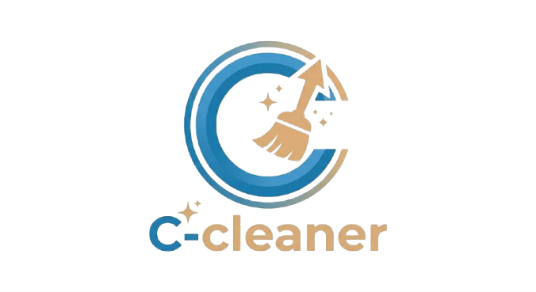

<div align="center">
  
  <h1>DiskCleaner</h1>
  <p><strong>Aplikasi Modern untuk Pembersihan File Sampah, Optimasi Ruang Penyimpanan, dan Analisis Disk</strong></p>
</div>

---

## 🚀 Tentang DiskCleaner
**DiskCleaner** adalah aplikasi pembersih penyimpanan otomatis yang dirancang untuk membantu pengguna membebaskan ruang hard drive/SSD dengan cepat dan aman. Aplikasi ini bekerja mendeteksi file sementara (*temp files*), *cache* aplikasi, serta sisa-sisa file log yang tidak terpakai tanpa merusak atau menghapus file sistem yang krusial! 🚀

---

## ✨ Fitur Utama
- 📦 **Pemindaian & Otomatisasi (Deep Scan):** Pindai direktori sistem secara terstruktur dan deteksi file sampah tersembunyi secara *real-time*.
- 📝 **Mode Aman & Filter Whitelist:** Sistem perlindungan bawaan untuk memastikan file penting milik OS atau sistem pengguna tidak sengaja terhapus.
- ✨ **Pembersihan Sekali Klik:** Hapus *cache*, file *temporary*, dan sisa instalasi aplikasi dengan instan tanpa mengganggu proses kerja komputer.
- 💰 **Laporan Ruang Bebas:** Menampilkan visualisasi jumlah ruang penyimpanan yang berhasil dibebaskan setelah pembersihan dilakukan.
- 📊 **Analisis Kategori Penyimpanan:** Pantau rincian file sampah berdasarkan jenisnya (Log, Cache, Temp, dll) melalui tampilan ringkas.

---

## 🧭 Panduan Penggunaan untuk Pengguna Baru

Selamat datang di DiskCleaner! Berikut adalah cara mudah menggunakan aplikasi ini:

### 1️⃣ Jalankan Aplikasi & Mulai Pemindaian
* Buka aplikasi **DiskCleaner** di perangkat Anda.
* Pilih lokasi drive yang ingin dipindai (misal: *Drive C:* atau *Drive D:*).
* Klik tombol **"Start Scan"** untuk memulai pemindaian file sampah secara aman.

### 2️⃣ Tinjau Hasil Pemindaian
* Setelah proses scan selesai, daftar file sampah beserta ukurannya akan ditampilkan di layar.
* Anda bisa melihat kategori file yang terdeteksi seperti *Temporary Files*, *Browser Cache*, atau *System Logs*.

### 3️⃣ Eksekusi Pembersihan
* Centang kategori file yang ingin Anda bersihkan.
* Klik tombol **"Clean Now"** di pojok kanan bawah.
* Konfirmasi proses, dan sistem akan menghapus file sampah secara permanen.

### 4️⃣ Cek Laporan & Ruang Tersedia
* Setelah pembersihan selesai, aplikasi akan memperbarui informasi total ruang penyimpanan yang berhasil dihemat.
* Anda dapat melakukan pemindaian berkala untuk menjaga performa penyimpanan tetap maksimal.

---

## 🛠️ Menjalankan Secara Lokal (Developer)
Karena aplikasi ini dikembangkan untuk dijalankan secara langsung di sistem lokal:
1. Clone atau unduh repository ini:
   
```bash
   git clone [https://github.com/mbal2508/DiskCleaner.git](https://github.com/mbal2508/DiskCleaner.git)

<div align="center">
  <p>Dibuat oleh <strong>Jemar Muhammad Firdiana</strong></p>
  <p><em>Sekbid 3 OSIS • 2026 All rights reserved.</em></p>
</div>
