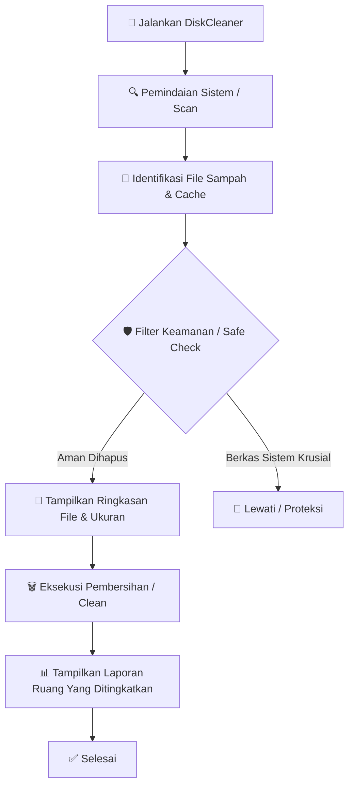

# 🧹 DiskCleaner

**Aplikasi pembersih penyimpanan otomatis yang cepat, aman, dan efisien untuk mengoptimalkan sistem Anda.**

[Fitur Utama](#-fitur-utama) • [Alur Kerja](#-alur-kerja-workflow) • [Target Pembersihan](#-direktori--target-pembersihan) • [Instalasi](#-instalasi--penggunaan) • [Lisensi](#-lisensi)

---

## 📖 Tentang Proyek

**DiskCleaner** adalah utilitas ringan yang dirancang untuk membantu pengguna membebaskan ruang penyimpanan (*disk space*) yang terbuang oleh file-file sementara (*temporary files*), sisa *cache*, file log lama, dan *junk files* lainnya.

Dengan antarmuka yang simpel dan fokus pada keamanan data, **DiskCleaner** memastikan proses akumulasi sampah sistem dapat dibersihkan secara transparan tanpa mengganggu stabilitas file penting sistem operasi.

---

## ✨ Fitur Utama

* 🔍 **Pemindaian Cepat & Akurat (*Fast Scan*):** Menelusuri direktori lokasi utama berdirinya file sampah dalam hitungan detik.
* 🛡️ **Sistem Perlindungan Berkas (*Safe Clean*):** Menghindari berkas-berkas krusial sistem dan hanya menghapus file yang aman untuk dibuang.
* 📊 **Laporan & Log Transparan:** Menyediakan rincian detail berkas apa saja yang telah dibersihkan beserta total kapasitas ruang (*space*) yang berhasil dipulihkan.
* ⚙️ **Ringan & Bebas Dependensi Berat:** Berjalan efisien tanpa mengonsumsi memori berlebih di latar belakang.
* 💻 **Antarmuka Ramah Pengguna:** Mudah dijalankan baik melalui antarmuka grafis (GUI) maupun perintah terminal/PowerShell.

---

## 🔄 Alur Kerja (*Workflow*)

Proses pembersihan di dalam **DiskCleaner** mengikuti skema alur kerja yang terstruktur dan aman:



---

## 📂 Direktori & Target Pembersihan

Secara bawaan, **DiskCleaner** memfokuskan pembersihan pada area-area berikut:

| Kategori | Deskripsi | Manfaat Pembersihan |
| :--- | :--- | :--- |
| **System Temp** | Berkas sementara aplikasi (`%TEMP%`, `C:\Windows\Temp`) | Membebaskan ruang dari berkas sisa sesi lalu |
| **Browser Cache** | *Cache* dan berkas sementara peramban web | Menyegarkan peramban & menjaga privasi |
| **Log Files** | Berkas log sistem dan laporan *crash* lama | Mengurangi beban berkas teks tidak terpakai |
| **Recycle Bin** | Tempat sampah sementara sistem | Menghapus berkas yang sudah dibuang secara permanen |
| **Windows Update Cache** | Sisa berkas pembaruan sistem lama | Mengembalikan ruang penyimpanan skala besar |

---

## 🚀 Instalasi & Penggunaan

### Prasyarat

Sebelum menggunakan aplikasi ini, pastikan sistem Anda memenuhi persyaratan berikut:
* **Sistem Operasi:** Windows 10 / 11
* **Hak Akses:** Administrator (direkomendasikan agar dapat menghapus file sementara tingkat sistem)

### Langkah-Langkah Instalasi

1. **Kloning Repositori:**
   ```bash
   git clone https://github.com/mbal2508/DiskCleaner.git
   ```

2. **Masuk ke Direktori Proyek:**
   ```bash
   cd DiskCleaner
   ```

3. **Jalankan Aplikasi:**
   * *Jika menggunakan skrip PowerShell:*
     ```powershell
     .\DiskCleaner.ps1
     ```
   * *Jika menggunakan Python:*
     ```bash
     python main.py
     ```

---

## 💡 Panduan Penggunaan Aman

> ⚠️ **Catatan Penting:** Disarankan untuk menutup aplikasi lain (terutama peramban web dan dokumen yang sedang terbuka) sebelum memulai proses pembersihan untuk hasil yang maksimal.

1. Buka terminal atau jalankan berkas eksekusi dengan opsi **Run as Administrator**.
2. Pilih opsi **Scan** untuk melihat akumulasi jumlah file sampah.
3. Tinjau hasil pemindaian dan total kapasitas yang dapat dihemat.
4. Tekan **Clean** / **Konfirmasi** untuk memulai penghapusan.
5. Periksa laporan akhir (*log*) yang dihasilkan setelah pembersihan selesai.

---

## 🤝 Kontribusi

Kontribusi dari komunitas sangat terbuka! Jika Anda ingin meningkatkan kinerja **DiskCleaner**, menambahkan target direktori baru, atau memperbaiki *bug*:

1. **Fork** repositori ini.
2. Buat *branch* fitur baru (`git checkout -b fitur/FiturKerenSaya`).
3. Simpan perubahan Anda (`git commit -m 'Menambahkan FiturKerenSaya'`).
4. Unggah ke *branch* (`git push origin fitur/FiturKerenSaya`).
5. Buat **Pull Request** baru.

---

## 📝 Lisensi

Proyek ini dilisensikan di bawah [**MIT License**](LICENSE). Anda bebas untuk mengedit, mendistribusikan, dan menggunakannya kembali baik untuk keperluan pribadi maupun komersial.

<div align="center">
  Dibuat dengan ❤️ oleh <a href="https://github.com/mbal2508">mbal2508</a>
</div>